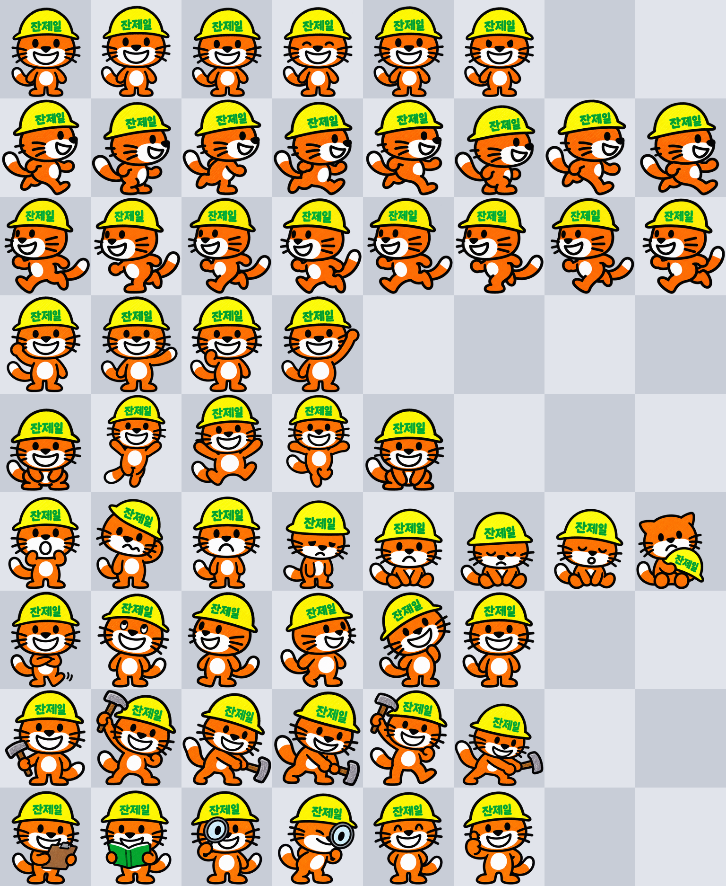

# 잔제일 Codex Pet

노란 안전모 쓴 크레용 카툰 주황 고양이 **잔제일**. OpenAI Codex 데스크톱 펫입니다. 오늘도 현장 출근.


## 설치

```bash
git clone https://github.com/LESANF/janjeil-codex-pet.git
mkdir -p ~/.codex/pets && cp -R janjeil-codex-pet/janjeil ~/.codex/pets/
```

Codex > Settings > Pets > Refresh > **잔제일** 선택 후 `/pet`

## 스펙

- `spritesheet.webp` 1536×1872, 8×9 grid, 192×208 cells
- idle / running-right / running-left / waving / jumping / failed / waiting / running(망치질) / review(돋보기)


